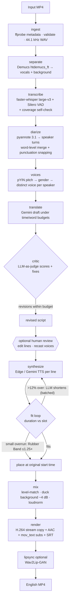

# Dub Studio — AI Video Translation & Dubbing (Chinese → English)

Dub Studio takes a Mandarin MP4 and produces an English-dubbed MP4 with the original
picture, music and sound effects. The Chinese dialogue is removed, not covered over. The
pipeline separates speech from background with Demucs, transcribes it with Whisper, and
identifies speakers with pyannote. Gemini then writes a timing-aware English script and
reviews it with a second "critic" pass. Each line is voiced per speaker and fitted to its
original time slot. The result is mixed back onto the music and muxed without
re-encoding the video. A web UI shows progress, an editable script and a two-track
timeline, and a per-job cost and time report.

| Requirement | Where |
|---|---|
| **Task 1** Video processing: MP4 input, 30 s–3 min validation, metadata, audio extraction | [`dubber/media.py`](dubber/media.py), [`stages/ingest.py`](dubber/stages/ingest.py) |
| **Task 2** Mandarin ASR with timestamps, silence detection, speakers, robust to music | [`stages/separate.py`](dubber/stages/separate.py), [`stages/transcribe.py`](dubber/stages/transcribe.py), [`stages/diarize.py`](dubber/stages/diarize.py) |
| **Task 3** Context-aware translation (idioms, tone, multi-speaker, length budgets) | [`dubber/translate.py`](dubber/translate.py), [`stages/translate.py`](dubber/stages/translate.py) |
| **Task 4** English TTS: consistent per-speaker voices, gender from pitch, emotion | [`stages/voices.py`](dubber/stages/voices.py), [`dubber/tts.py`](dubber/tts.py) |
| **Task 5** Sync and mixing: fit loop, original voices removed, background kept | [`stages/synthesize.py`](dubber/stages/synthesize.py), [`stages/mix.py`](dubber/stages/mix.py), [`dubber/align.py`](dubber/align.py) |
| **Task 6** Final MP4 (H.264 + AAC), duration-checked, downloadable | [`stages/render.py`](dubber/stages/render.py) |
| **Bonus A** Lip sync (Wav2Lip-GAN, separate environment) | [`stages/lipsync.py`](dubber/stages/lipsync.py) |
| **Bonus B** SRT (EN + ZH), other target languages, web UI with upload and preview, speaker→voice mapping, translation editing before dubbing, progress indicator, retry/resume, cost and time report | [`dubber/api/`](dubber/api), [`web/`](web) |

Docs: [Technical documentation](docs/TECHNICAL.md) · [Cost analysis](docs/COST_ANALYSIS.md) · [Engineering discussion](docs/DISCUSSION.md)

---

## Architecture



The stages run in sequence under a checkpointing runner ([`dubber/pipeline/`](dubber/pipeline)).
Each stage declares its output files; completed stages are skipped on resume; transient
failures (rate limits, timeouts) are retried with backoff. GPU stages hold a cross-process
lock, because on a 4 GB GPU two models running at once overflow VRAM.

## Quickstart

### Prerequisites
- **Python 3.12** (3.11 also works)
- **FFmpeg** on `PATH`, built with `librubberband` (the gyan.dev "full" build on Windows has it)
- **NVIDIA GPU** recommended (developed on an RTX 3050 Laptop, 4 GB). CPU works but is slow.
- **Node 20+**, only to build the web UI
- A **Gemini API key** ([AI Studio](https://aistudio.google.com/apikey)). The free tier is enough for translation.
- A **Hugging Face token**. With it, accept the terms of **both**
  [pyannote/speaker-diarization-3.1](https://hf.co/pyannote/speaker-diarization-3.1) and
  [pyannote/segmentation-3.0](https://hf.co/pyannote/segmentation-3.0).

### Install (Windows PowerShell)
```powershell
py -3.12 -m venv .venv
.\.venv\Scripts\python -m pip install --upgrade pip
.\.venv\Scripts\python -m pip install torch==2.7.1 torchaudio==2.7.1 --index-url https://download.pytorch.org/whl/cu126
.\.venv\Scripts\python -m pip install -e ".[ml,ai,api,dev]"
Copy-Item .env.example .env      # then fill in GEMINI_API_KEY and HF_TOKEN
cd web; npm install; npm run build; cd ..
```
On Linux or macOS, use `python3.12 -m venv .venv && source .venv/bin/activate` and the same pip commands. Use the CPU torch wheel if you have no CUDA.

### Run
```powershell
.\.venv\Scripts\dubber serve                 # web UI + API on http://127.0.0.1:8000
.\.venv\Scripts\dubber run video.mp4 -v      # CLI end-to-end
.\.venv\Scripts\dubber resume <job_id>       # resume a failed/interrupted job
.\.venv\Scripts\dubber resume <job_id> -f translate   # force a stage (and everything after it) to re-run
.\.venv\Scripts\dubber probe video.mp4       # print metadata only
```
Models (Whisper large-v3 ≈ 3 GB, htdemucs_ft, pyannote) download on first use.

### Try it without your own video
```powershell
.\.venv\Scripts\python scripts\make_test_video.py samples\two_speakers_music.mp4
.\.venv\Scripts\dubber run samples\two_speakers_music.mp4
```
This generates a 58 s, two-speaker (male and female) Mandarin dialogue over background music. It includes an idiom, a fast line, a long sentence and a 4 s silence. The ground truth is saved alongside it: clean speech and music stems and the script with timings.

## Outputs (per job, in `jobs/<job_id>/`)

| File | Contents |
|---|---|
| `input.mp4` | uploaded source |
| `metadata.json` | duration (container/video/audio), resolution, fps, codecs |
| `audio_original.wav` | 44.1 kHz stereo soundtrack |
| `vocals.wav` / `background.wav` | Demucs speech stem / music + SFX stem |
| `transcript_raw.json`, `asr_stats.json` | ASR before diarization; VAD regions, recovered regions, low-confidence lines |
| `diarization.json` | pyannote speaker turns |
| `transcript.json` | Chinese transcript: segments, word timestamps, speaker, confidence |
| `voices.json` | speaker → gender, median F0, speaking time, voice, style (editable) |
| `translation.json` | English lines with emotion, time budget, and the critic's scores and revisions (editable) |
| `tts/` | per-line synthesized clips (content-hash cached) |
| `dub_track.json` | placement, raw/final duration, tempo, rewrite count per line |
| `dub_voice.wav` | English speech only, on the video timeline |
| `dub_mix.wav` | final soundtrack |
| `subtitles_en.srt` / `subtitles_zh.srt` | English subtitles (dub timing) / Chinese subtitles |
| `output.mp4` | **final dubbed video** (H.264 copy, AAC 192k, English soft subtitles) |
| `output_lipsync.mp4` | lip-synced variant (only when enabled) |
| `report.json`, `manifest.json` | per-stage status, timing, attempts, API cost ledger |

## Configuration (`.env`, prefix `DUBBER_`)

| Variable | Default | Meaning |
|---|---|---|
| `GEMINI_API_KEY` | — | required for translation (and Gemini TTS) |
| `HF_TOKEN` | — | required for pyannote diarization |
| `DUBBER_JOBS_DIR` | `jobs` | job workspaces |
| `DUBBER_DEVICE` | `auto` | `auto` \| `cuda` \| `cpu` |
| `DUBBER_MIN_DURATION_S` / `MAX_DURATION_S` | `30` / `180` | accepted input length |
| `DUBBER_SEPARATION_MODEL` | `htdemucs_ft` | or `htdemucs` (3.5× faster, −2.3 dB SDR) |
| `DUBBER_WHISPER_MODEL` | `large-v3` | any faster-whisper model |
| `DUBBER_ASR_BATCHED` | `false` | batched decoding: faster on long videos, less context |
| `DUBBER_TRANSLATION_MODEL` | `gemini-3.8-flash` | falls back to `gemini-3.5-flash`, `gemini-flash-latest` |
| `DUBBER_TTS_PROVIDER` | `edge` | `edge` (free) \| `gemini` (emotion-steerable) |
| `DUBBER_TTS_MODEL` | `gemini-3.8-flash-tts` | used when the provider is `gemini` |
| `DUBBER_TARGET_LANGUAGE` | `English` | any language the LLM supports (Gemini TTS is multilingual) |
| `DUBBER_LIPSYNC_PYTHON` / `DUBBER_LIPSYNC_REPO` | `.venv-lipsync`, `third_party/Wav2Lip` | lip-sync environment |

## Tests
```powershell
.\.venv\Scripts\python -m pytest -q
```
The unit tests (no GPU or network) cover:
- media probing and validation;
- the runner's checkpoint, resume, retry and progress behaviour;
- speaker segmentation, including punctuation snapping and fragment merging;
- coverage-gap detection and time budgets;
- fit decisions, Rubber Band time-stretch, ducking, SRT output;
- translation with a stubbed LLM: missing-line retry, critic budget guard, circuit breaker;
- the REST API: upload validation, path-traversal protection, edits that preserve timings;
- lip-sync command construction.

Tests that need real models are marked `gpu`, and tests that call external APIs are marked `network`.

## Scripts

| Script | Purpose |
|---|---|
| `scripts/make_test_video.py` | synthetic test video + ground truth |
| `scripts/bench_separation.py` | Demucs speed vs SDR against ground truth |
| `scripts/make_ui_demo_job.py` | fake finished job for UI demos without the ML stack |
| `scripts/setup_lipsync.ps1` | builds the isolated Wav2Lip environment and downloads checkpoints |

## Project layout
```
dubber/
  pipeline/      job workspace + manifest, Stage base, checkpointing runner
  stages/        ingest, separate, transcribe, diarize, voices, translate,
                 synthesize, mix, render, lipsync (+ wav2lip_runner)
  api/           FastAPI app + single-GPU job manager (SSE progress)
  align.py       pure timing logic (speaker merge, budgets, fit plan)
  translate.py   dubbing-script prompts: draft, critic, shorten
  llm.py         Gemini client: structured output, fallback chain, circuit breaker
  tts.py         Edge / Gemini TTS providers with caching + silence trim
  media.py       ffprobe/ffmpeg wrappers (probe, validate, extract, time-stretch)
  pricing.py     list prices for the per-job cost ledger
web/             React + Vite + Tailwind UI ("Dub Studio")
scripts/         test-video generator, benchmarks, setup
tests/           pytest suite
docs/            technical documentation, cost analysis, discussion answers
```

## Troubleshooting

| Symptom | Cause / fix |
|---|---|
| `has not accepted the terms of pyannote/segmentation-3.0` | Open the model page while logged in and click **Agree**, then **Retry**. Both pyannote repos are gated. |
| `Gemini 503 … falling back to …` in logs | Google capacity spike. The client fails over to the next model and puts the overloaded one in a 2-minute cooldown. No action needed. |
| `cublas64_12.dll not found` | CTranslate2 reuses the CUDA DLLs bundled with PyTorch. Import torch before faster-whisper, as `dubber.ml.device()` does. |
| A run is very slow while another is active | GPU stages hold `jobs/.gpu.lock`. On 4 GB VRAM, concurrent models would spill into system RAM and run about 100× slower, so jobs queue instead. |
| `Lip sync is not set up` | Run `powershell -ExecutionPolicy Bypass -File scripts\setup_lipsync.ps1`. |
