# Dub Studio — AI Video Translation & Dubbing (Chinese → English)

Dub Studio takes a Mandarin MP4 and produces an English-dubbed MP4 with the original
picture, music and sound effects. The Chinese dialogue is removed, not covered over. The
pipeline separates speech from background with Demucs, transcribes it with Whisper, and
identifies speakers with pyannote. Gemini then writes a timing-aware English script and
reviews it with a second "critic" pass. Each line is voiced per speaker and fitted to its
original time slot. The result is mixed back onto the music and muxed without
re-encoding the video. A web UI shows progress, an editable script and a two-track
timeline, and a per-job cost and time report.

Docs: [Technical documentation](docs/TECHNICAL.md) · [Cost analysis](docs/COST_ANALYSIS.md) · [Engineering discussion](docs/DISCUSSION.md) · [Evaluation](docs/EVALUATION.md) · [Technology review (SOTA, Oct 2026)](reports/Dubbing%20pipeline%20technology%20review.md)

## Requirements checklist

Status: ✅ done · ⚠️ done with a stated limitation · ⏳ pending

| Requirement (assessment PDF) | Where | Status |
|---|---|---|
| **Task 1**: MP4 input, 30 s–3 min validation, audio extraction, audio/video duration, resolution, fps, quality kept | [`media.py`](dubber/media.py), [`stages/ingest.py`](dubber/stages/ingest.py); H.264 stream copy in [`stages/render.py`](dubber/stages/render.py) | ✅ |
| **Task 2**: Mandarin ASR, word + segment timestamps, speech/silence (Silero VAD), speakers, robust to music/noise | ASR runs on the Demucs vocal stem ([`separate.py`](dubber/stages/separate.py)); [`transcribe.py`](dubber/stages/transcribe.py) has a coverage self-check; [`diarize.py`](dubber/stages/diarize.py) merges over-split speakers | ⚠️ homophones the ASR is confident about are not caught (冰火 vs 兵火, confidence 0.94) |
| **Task 3**: meaning, context, idioms, tone, multi-speaker, length fitted to duration | [`translate.py`](dubber/translate.py): full-conversation context, per-line word budgets, emotion tags, ASR-aware homophone repair (`asr_fix`), critic pass | ⚠️ budgets use English words/second for every target language |
| **Task 4**: natural speech, consistent voice per speaker, male/female voices, emotion, rate fitted, no excessive speed | [`voices.py`](dubber/stages/voices.py) (gender + pitch-matched casting), [`tts.py`](dubber/tts.py), fit loop in [`synthesize.py`](dubber/stages/synthesize.py) (tempo capped at 1.25×) | ⚠️ emotion only with Gemini TTS; Edge voices are neutral |
| **Task 5**: aligned to source segments, pauses kept, no false overlaps, Chinese removed, music/SFX kept, synced track | [`align.py`](dubber/align.py) time budgets, [`synthesize.py`](dubber/stages/synthesize.py) placement at the source start, [`mix.py`](dubber/stages/mix.py) (Demucs background, ducking, loudness match) | ✅ |
| **Task 6**: playable MP4, H.264 + AAC, visuals and duration preserved, downloadable | [`render.py`](dubber/stages/render.py) (checks duration drift is under 0.25 s), `GET /api/jobs/{id}/files/output.mp4` | ✅ |
| **Bonus A**: lip sync | [`lipsync.py`](dubber/stages/lipsync.py) + [`wav2lip_runner.py`](dubber/stages/wav2lip_runner.py) (Wav2Lip-GAN, speech frames only) | ⏳ verified on a 22 s talking-head sample. The run on the real clip must be started by the user ([command](#lip-sync)), because running third-party code needs their approval |
| **Bonus B**: SRT subtitles | `subtitles_en.srt` / `subtitles_zh.srt`, plus a soft subtitle track in the MP4 | ✅ |
| **Bonus B**: additional target languages | upload option; native Edge voices for es/fr/de/ja/ko/si/hi ([`voices_catalog.py`](dubber/voices_catalog.py) `catalog_for`); Gemini voices are multilingual | ⚠️ timing budget is tuned for English |
| **Bonus B**: web UI with upload and preview | [`web/`](web), [`dubber/api/`](dubber/api) | ✅ |
| **Bonus B**: speaker-to-voice mapping | script editor cast panel, with per-voice preview (`GET /api/voices/{provider}/{voice}/preview`) | ✅ |
| **Bonus B**: translation editing before dubbing | review pause after translation, plus per-line re-voice (`POST /api/jobs/{id}/lines/{line}/regenerate`) | ✅ |
| **Bonus B**: progress indicator | SSE `GET /api/jobs/{id}/events`, signal-chain UI | ✅ |
| **Bonus B**: retry and recovery | checkpointing runner ([`pipeline/`](dubber/pipeline)), `POST /retry`, `dubber resume` | ✅ |
| **Bonus B**: per-video cost and time report | `manifest.json` cost ledger, `GET /api/jobs/{id}/report`, quality panel `GET /api/jobs/{id}/quality` | ✅ |
| **Deliverable A**: source, README, dependency list, env example, run instructions, ≥3 tests | this repo, [`requirements.txt`](requirements.txt) / [`pyproject.toml`](pyproject.toml), [`.env.example`](.env.example), 75 unit tests | ✅ |
| **Deliverable B**: original video, dubbed video, transcription, translation, speaker mapping, English audio | [`scripts/export_demo.py`](scripts/export_demo.py) ([below](#demo-deliverables)) | ✅ (the user records the demo) |
| **Deliverable C**: technical documentation (7 sections) | [`docs/TECHNICAL.md`](docs/TECHNICAL.md) | ✅ |
| **Deliverable D**: cost analysis for 1/5/30/60 min (API, infrastructure, time) | [`docs/COST_ANALYSIS.md`](docs/COST_ANALYSIS.md) | ✅ (prices are third-party estimates) |
| **Test scenarios**: one speaker, two speakers, music, fast speech, silences, long sentences, noise | [`scripts/make_scenarios.py`](scripts/make_scenarios.py), [`scripts/evaluate.py`](scripts/evaluate.py), [`docs/EVALUATION.md`](docs/EVALUATION.md) | ⏳ 2 of the 6 runs (one speaker, silent sections) are waiting on the Gemini free-tier daily quota reset |
| **Discussion questions** 1–9 | [`docs/DISCUSSION.md`](docs/DISCUSSION.md) | ✅ |

---

## Architecture

```mermaid
flowchart TD
    A[Input MP4] --> B[ingest<br/>ffprobe metadata · validate · 44.1 kHz WAV]
    B --> C[separate<br/>Demucs htdemucs_ft → vocals + background]
    C --> D[transcribe<br/>faster-whisper large-v3 + Silero VAD<br/>+ coverage self-check]
    D --> E[diarize<br/>pyannote 3.1 → speaker turns<br/>over-split merge · punctuation snapping · short-line merge]
    E --> F[voices<br/>pYIN pitch → gender → closest-pitch voice per speaker]
    F --> G[translate<br/>Gemini draft under time/word budgets<br/>low-confidence ASR words flagged → asr_fix]
    G --> H{critic<br/>LLM-as-judge scores + fixes}
    H -- revisions within budget --> G2[revised script]
    G2 --> R{{optional human review<br/>edit lines · recast voices}}
    R --> I[synthesize<br/>Edge / Gemini TTS per line]
    I --> J{fit loop<br/>duration vs slot}
    J -- ">12% over: LLM shortens (batched)" --> I
    J -- "small overrun: Rubber Band ≤1.25×" --> K
    J -- fits --> K[place at original start time]
    K --> L[mix<br/>level-match · duck background −4 dB · loudnorm]
    L --> M[render<br/>H.264 stream copy + AAC + mov_text subs + SRT]
    M --> N[lipsync optional<br/>Wav2Lip-GAN]
    N --> O[English MP4]
```



The stages run in sequence under a checkpointing runner ([`dubber/pipeline/`](dubber/pipeline)).
Each stage declares its output files; completed stages are skipped on resume; transient
failures (rate limits, timeouts) are retried with backoff. GPU stages hold a cross-process
lock, because on a 4 GB GPU two models running at once overflow VRAM.

## Quickstart

### Prerequisites
- **Python 3.12** (3.11 also works)
- **FFmpeg** on `PATH`, built with `librubberband` (the gyan.dev "full" build on Windows has it)
- **NVIDIA GPU** recommended (developed on an RTX 3050 Laptop, 4 GB). CPU works but is slow.
- **Node 20+**, only to build the web UI
- A **Gemini API key** ([AI Studio](https://aistudio.google.com/apikey)). The free tier is enough for translation.
- A **Hugging Face token**. With it, accept the terms of **both**
  [pyannote/speaker-diarization-3.1](https://hf.co/pyannote/speaker-diarization-3.1) and
  [pyannote/segmentation-3.0](https://hf.co/pyannote/segmentation-3.0).

### Install (Windows PowerShell)
```powershell
py -3.12 -m venv .venv
.\.venv\Scripts\python -m pip install --upgrade pip
.\.venv\Scripts\python -m pip install torch==2.7.1 torchaudio==2.7.1 --index-url https://download.pytorch.org/whl/cu126
.\.venv\Scripts\python -m pip install -r requirements.txt   # pinned, verified set
.\.venv\Scripts\python -m pip install -e .
Copy-Item .env.example .env      # then fill in GEMINI_API_KEY and HF_TOKEN
cd web; npm install; npm run build; cd ..
```
On Linux or macOS, use `python3.12 -m venv .venv && source .venv/bin/activate` and the same pip commands. Use the CPU torch wheel if you have no CUDA. `requirements.txt` pins the exact versions verified end-to-end. `pip install -e ".[ml,ai,api,dev]"` installs the same packages with looser bounds.

### Run
```powershell
.\.venv\Scripts\dubber serve                 # web UI + API on http://127.0.0.1:8000
.\.venv\Scripts\dubber run video.mp4 -v      # CLI end-to-end
.\.venv\Scripts\dubber resume <job_id>       # resume a failed/interrupted job
.\.venv\Scripts\dubber resume <job_id> -f translate   # force a stage (and everything after it) to re-run
.\.venv\Scripts\dubber probe video.mp4       # print metadata only
```
Models (Whisper large-v3 ≈ 3 GB, htdemucs_ft, pyannote) download on first use.

### Try it without your own video
```powershell
.\.venv\Scripts\python scripts\make_test_video.py samples\two_speakers_music.mp4
.\.venv\Scripts\dubber run samples\two_speakers_music.mp4
```
This generates a 58 s, two-speaker (male and female) Mandarin dialogue over background music. It includes an idiom, a fast line, a long sentence and a 4 s silence. The ground truth is saved alongside it: clean speech and music stems and the script with timings.

### Demo deliverables
```powershell
.\.venv\Scripts\python scripts\export_demo.py <job_id>      # → demo/<job_id>/
```
| Assessment deliverable (B) | Exported file |
|---|---|
| Original Chinese video | `original_chinese.mp4` |
| Final English-dubbed video | `english_dubbed.mp4` (+ `english_dubbed_lipsync.mp4` if lip sync ran) |
| Chinese transcription | `chinese_transcript.json` (speakers, word timestamps, confidence) + `.srt` |
| English translation | `english_translation.json` (emotion, critic review, `asr_fix`) + `.srt` |
| Speaker mapping | `speaker_mapping.json` (gender, median pitch, voice) and a table in `README.md` |
| Generated English audio | `english_audio_dialogue.wav` (speech only), `english_audio_full_mix.wav` (with music/SFX) |
| Time and cost | `report.json` |

### Lip sync
Lip sync runs in an isolated environment, `.venv-lipsync`, because Wav2Lip's dependencies conflict with the main stack. Set it up once with `powershell -ExecutionPolicy Bypass -File scripts\setup_lipsync.ps1`. Then either tick **AI lip sync** at upload, or run it on a finished job:
```powershell
.\.venv\Scripts\python -c "from pathlib import Path; from dubber.pipeline import Job, Pipeline; from dubber.stages.lipsync import LipSyncStage; Pipeline([LipSyncStage()]).run(Job(Path('jobs/<job_id>')), force=['lipsync'])"
```

## Outputs (per job, in `jobs/<job_id>/`)

| File | Contents |
|---|---|
| `input.mp4` | uploaded source |
| `metadata.json` | duration (container/video/audio), resolution, fps, codecs |
| `audio_original.wav` | 44.1 kHz stereo soundtrack |
| `vocals.wav` / `background.wav` | Demucs speech stem / music + SFX stem |
| `transcript_raw.json`, `asr_stats.json` | ASR before diarization; VAD regions, recovered regions, low-confidence lines |
| `diarization.json`, `diarization_meta.json` | pyannote speaker turns; clusters, similarities, pitch and every speaker-merge decision |
| `transcript.json` | Chinese transcript: segments, word timestamps, speaker, confidence |
| `voices.json`, `voice_casting.json` | speaker → gender, median F0, speaking time, voice, style (editable); speaker vs voice pitch |
| `translation.json` | English lines with emotion, time budget, `asr_fix`, and the critic's scores and revisions (editable) |
| `tts/` | per-line synthesized clips (content-hash cached) |
| `dub_track.json` | placement, raw/final duration, tempo, rewrite count per line |
| `dub_voice.wav` | English speech only, on the video timeline |
| `dub_mix.wav` | final soundtrack |
| `subtitles_en.srt` / `subtitles_zh.srt` | English subtitles (dub timing) / Chinese subtitles |
| `output.mp4` | **final dubbed video** (H.264 copy, AAC 192k, English soft subtitles) |
| `output_lipsync.mp4` | lip-synced variant (only when enabled) |
| `report.json`, `manifest.json` | per-stage status, timing, attempts, API cost ledger |
| `source_loudness.json` | integrated loudness of the source, measured once and reused by every re-mix |

Job options set at upload: `target_language`, `tts_provider`, `review` (pause after translation), `lipsync`, and `num_speakers`. If `num_speakers` is set, automatic speaker merging is skipped. From the CLI or API you can also pass `min_speakers` / `max_speakers` and `critic`.

## REST API (selection)

| Endpoint | Purpose |
|---|---|
| `POST /api/jobs` | upload an MP4 plus options; starts the pipeline |
| `GET /api/jobs/{id}` · `GET /api/jobs/{id}/events` | status · live progress (SSE) |
| `GET/PUT /api/jobs/{id}/translation` · `/voices` · `/transcript` | review and edit; edits preserve timings |
| `POST /api/jobs/{id}/continue` · `/retry` | resume after review · resume a failed job |
| `POST /api/jobs/{id}/lines/{line}/regenerate` | re-voice one edited line, then re-mix and re-render (measured 8.1–8.4 s with Edge before source loudness was cached) |
| `GET /api/voices?provider=&language=` · `GET /api/voices/{provider}/{voice}/preview` | voices that speak the target language · cached voice sample (1.3 s, ~0.03 s cached) |
| `GET /api/jobs/{id}/report` · `/quality` | time and cost report · ASR, speaker, sync and critic warnings |
| `GET /api/jobs/{id}/files/{name}` | whitelisted artifact download (supports HTTP range requests) |

## Configuration (`.env`, prefix `DUBBER_`)

| Variable | Default | Meaning |
|---|---|---|
| `GEMINI_API_KEY` | — | required for translation (and Gemini TTS) |
| `HF_TOKEN` | — | required for pyannote diarization |
| `DUBBER_JOBS_DIR` | `jobs` | job workspaces |
| `DUBBER_DEVICE` | `auto` | `auto` \| `cuda` \| `cpu` |
| `DUBBER_MIN_DURATION_S` / `MAX_DURATION_S` | `30` / `180` | accepted input length |
| `DUBBER_SEPARATION_MODEL` | `htdemucs_ft` | or `htdemucs` (3.5× faster, −2.3 dB SDR) |
| `DUBBER_WHISPER_MODEL` | `large-v3` | any faster-whisper model |
| `DUBBER_ASR_BATCHED` | `false` | batched decoding: faster on long videos, less context |
| `DUBBER_TRANSLATION_MODEL` | `gemini-3.8-flash` | falls back to `gemini-3.5-flash`, `gemini-flash-latest` |
| `DUBBER_TTS_PROVIDER` | `edge` | `edge` (free) \| `gemini` (emotion-steerable) |
| `DUBBER_TTS_MODEL` | `gemini-3.8-flash-tts` | used when the provider is `gemini` |
| `DUBBER_TARGET_LANGUAGE` | `English` | any language the LLM supports. Gemini voices are multilingual; Edge has native voices for es/fr/de/ja/ko/si/hi |
| `DUBBER_LIPSYNC_PYTHON` / `DUBBER_LIPSYNC_REPO` | `.venv-lipsync`, `third_party/Wav2Lip` | lip-sync environment |

## Tests
```powershell
.\.venv\Scripts\python -m pytest -q
```
75 unit tests (no GPU or network) cover:
- media probing and validation;
- the runner's checkpoint, resume, retry and progress behaviour;
- speaker segmentation, including punctuation snapping, fragment merging and short-line merging, using the real cases from the test clip;
- speaker over-split merging with the embedding similarities and pitch measured on the clips;
- pitch-matched voice casting;
- coverage-gap detection and minimum time budgets;
- fit decisions, Rubber Band time-stretch, ducking, SRT output;
- translation with a stubbed LLM: missing-line retry, uncertain-word markup and `asr_fix`, critic budget guard, circuit breaker, daily-quota classification;
- single-line re-voice;
- the REST API: upload validation, path-traversal protection, edits that preserve timings, quality report, language-filtered voice catalog;
- evaluation metrics (CER, coverage, silence);
- lip-sync command construction.

Tests that need real models are marked `gpu`, and tests that call external APIs are marked `network`.

## Scripts

| Script | Purpose |
|---|---|
| `scripts/make_test_video.py` | synthetic test video + ground truth |
| `scripts/make_scenarios.py` | the assessment's test scenarios (one speaker, fast, silences, long sentences, noisy) with ground truth |
| `scripts/evaluate.py` | CER, coverage, speaker/gender accuracy, silence handling, sync, latency and cost per job or scenario |
| `scripts/export_demo.py` | collects the Working Demo deliverables from a job |
| `scripts/bench_separation.py` | Demucs speed vs SDR against ground truth |
| `scripts/make_ui_demo_job.py` | fake finished job for UI demos without the ML stack |
| `scripts/setup_lipsync.ps1` | builds the isolated Wav2Lip environment and downloads checkpoints |

## Project layout
```
dubber/
  pipeline/      job workspace + manifest, Stage base, checkpointing runner
  stages/        ingest, separate, transcribe, diarize, voices, translate,
                 synthesize, mix, render, lipsync (+ wav2lip_runner)
  api/           FastAPI app + single-GPU job manager (SSE progress)
  align.py       pure timing logic (speaker merge, budgets, fit plan)
  translate.py   dubbing-script prompts: draft, critic, shorten
  llm.py         Gemini client: structured output, fallback chain, circuit breaker
  tts.py         Edge / Gemini TTS providers with caching + silence trim
  media.py       ffprobe/ffmpeg wrappers (probe, validate, extract, time-stretch)
  pricing.py     list prices for the per-job cost ledger
web/             React + Vite + Tailwind UI ("Dub Studio")
scripts/         test-video generator, benchmarks, setup
tests/           pytest suite
docs/            technical documentation, cost analysis, discussion answers
```

## Troubleshooting

| Symptom | Cause / fix |
|---|---|
| `has not accepted the terms of pyannote/segmentation-3.0` | Open the model page while logged in and click **Agree**, then **Retry**. Both pyannote repos are gated. |
| `Gemini 503 … falling back to …` in logs | Google capacity spike. The client fails over to the next model and puts the overloaded one in a 2-minute cooldown. No action needed. |
| `cublas64_12.dll not found` | CTranslate2 reuses the CUDA DLLs bundled with PyTorch. Import torch before faster-whisper, as `dubber.ml.device()` does. |
| A run is very slow while another is active | GPU stages hold `jobs/.gpu.lock`. On 4 GB VRAM, concurrent models would spill into system RAM and run about 100× slower, so jobs queue instead. |
| `Lip sync is not set up` | Run `powershell -ExecutionPolicy Bypass -File scripts\setup_lipsync.ps1`. |
| `Gemini daily free-tier quota is exhausted for every fallback model` | The free tier allows about 20 requests per model per day. Enable billing on the key (about $0.007–0.016 per minute of video), set `DUBBER_TRANSLATION_MODEL` to a `-lite` model, or wait for the daily reset. Edge voices and per-line re-voicing don't use Gemini. |
| A dub has too many speakers | Set **Speakers** at upload (`num_speakers`), or give the same voice to duplicate speakers in the cast panel and click **Save & Generate**. |
